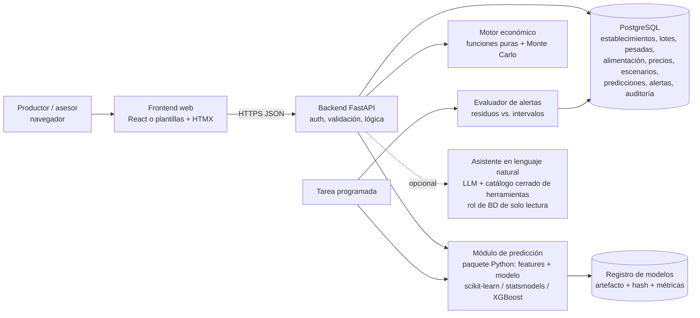

# Viabilidad técnica y científica de un TIF: sistema de apoyo a decisiones económicas en feedlots

**Fecha de verificación de todas las fuentes:** 24/10/2026
**Alcance:** investigación de datos, estado del arte, formulación económica, diseño y viabilidad para un Trabajo Final de Ingeniería en Informática (Universidad de Mendoza).

---

## 0. Cómo se hizo esta investigación (leer primero)

Este informe distingue cuatro niveles de evidencia. Cada afirmación sobre un dataset o artículo tiene una etiqueta:

| Etiqueta | Significado |
|---|---|
| **[INSPECCIONADO]** | Descargué los archivos y los analicé con código. Los números salen de esa inspección. |
| **[VERIFICADO-BUSCADOR]** | Lo confirmé con resultados de búsqueda que citan la página original, pero no pude abrir la página ni los archivos. |
| **[PENDIENTE]** | No lo pude confirmar. Tenés que verificarlo vos antes de usarlo. |
| **[CONOCIMIENTO PREVIO]** | Viene de mi conocimiento general del área, sin una fuente consultada en esta sesión. Se usa poco y siempre marcado. |

**Limitación importante del entorno.** Trabajé en un contenedor con la red restringida. Pude descargar repositorios públicos de GitHub y hacer búsquedas web, pero **no pude abrir** data.mendeley.com, zenodo.org, kaggle.com, agdatacommons.nal.usda.gov, figshare, repositorio.inta.gob.ar, mla.com.au, editoriales (MDPI, ScienceDirect, OUP) ni PMC: el proxy rechazó todas esas conexiones. Por eso, varios candidatos clave quedan **[PENDIENTE]** de inspección de archivos. Indico en cada caso qué tenés que mirar. Para habilitar esos dominios en este entorno, se agregan en *Network access → Allowed domains* de la configuración del entorno cloud ([documentación](https://code.claude.com/docs/en/cloud-environments#network-access)), o los revisás desde tu navegador.

Los experimentos reproducibles de este informe están en `tif-feedlot/experimentos/`.

---

## Entregable 1. Resumen ejecutivo

**Problema.** Decidir, con anticipación y fundamento económico, si conviene seguir engordando un lote h días más (7/14/21) o venderlo ahora. Conviene descomponerlo en dos problemas distintos: (1) **predecir** el peso, la ganancia y el consumo futuros, y (2) **comparar económicamente** "vender hoy" contra "continuar h días" usando esas predicciones, los precios y los costos.

**Enfoque técnico recomendado.**
- La decisión económica se resuelve con **fórmulas deterministas de análisis marginal** (valor incremental de continuar menos costos evitables y costo de oportunidad) más **simulación Monte Carlo** de la incertidumbre. No hace falta aprendizaje automático (ML) para esa parte, y no conviene usarlo.
- El ML se usa solo para **predecir la ganancia de peso y el peso a h días** con intervalos de incertidumbre, comparado contra líneas base simples. Las alertas se generan a partir de los **residuos** (observado − predicho), no con aprendizaje no supervisado.
- El lenguaje natural es opcional y va al final: herramientas controladas y de solo lectura, nunca SQL libre.

**Datos encontrados realmente.**
- **No encontré ningún dataset público, descargable y verificado que combine, por animal o por lote, una serie temporal de pesos con el consumo real de un feedlot.** No hay ningún candidato en categoría A confirmada.
- El dataset más prometedor está **sin verificar**: un depósito de Zenodo de 2026 con 12 ensayos, 1.152 animales, de 2019 a 2024, en un feedlot experimental de São Paulo, que modela consumo de materia seca (DMI) y ganancia diaria (ADG) ([zenodo.org/records/23199908](https://zenodo.org/records/23199908)). No pude ver sus archivos.
- El repositorio FeedIntake-AI **[INSPECCIONADO]** publica el código, pero **no los datos**. Además, sus datos de consumo diario individual **no contienen peso corporal**.
- Lo único real que efectivamente descargué y analicé son series de pesos sin consumo, de ensayos clásicos (por ejemplo, `kenward.cattle`: 60 animales × 11 pesajes en 133 días, licencia MIT). Sirven para el módulo de predicción de peso y para validar el software, no para el problema completo.

**Principal riesgo.** Los datos. Sin una serie de pesos intermedios y consumo de lotes reales de feedlot, que incluya la fase final del engorde (donde la ganancia cae y la decisión importa), no se puede validar empíricamente la parte central de la propuesta. En los feedlots comerciales, además, suele registrarse el **alimento entregado por corral**, no el consumo individual. Y hay que confirmar con productores con qué frecuencia se pesa durante el engorde **[PENDIENTE]**.

**Veredicto preliminar.** **Viable solo si se reformula.** Como "IA que determina el momento óptimo de faena", no es defendible con los datos disponibles. Como sistema de software que integra (a) registro de lotes y pesadas, (b) un modelo de pronóstico de peso validado contra líneas base, (c) un motor económico marginal con incertidumbre y (d) una evaluación por simulación del **arrepentimiento (regret) de decisión**, sí es realizable y defendible. Hay una condición: conseguir antes de comprometer el alcance al menos uno de estos dos: la verificación de los archivos de Zenodo 23199908 o datos de un establecimiento o grupo del INTA.

---

## Entregable 2. Inventario de datasets

### 2.1 Tabla comparativa

Categorías: **A** = apto para el objetivo principal; **B** = parcialmente apto; **C** = referencia; **D** = no apto o sin acceso.

| # | Recurso | Qué contiene (según evidencia) | Animales / tamaño | Resolución temporal | ¿Peso + consumo del mismo animal/lote? | Precios/costos | Licencia | Acceso | Evidencia | Cat. |
|---|---|---|---|---|---|---|---|---|---|---|
| 1 | **Zenodo 23199908** – "Longitudinal AI predictions of feedlot beef cattle performance from accumulated environmental conditions" ([link](https://zenodo.org/records/23199908)) | DMI, ADG, consumo de agua, índices ambientales; Campanelli Innovation Center, Altair-SP, Brasil; autores de Unesp, U. Idaho y UNIR | 12 ensayos, 1.152 animales, 2019–2024 | Longitudinal (según el título y el resumen) | Probable, sin confirmar | No surge | Pendiente | Pendiente: no sé si incluye archivos de datos o solo el preprint | VERIFICADO-BUSCADOR (metadatos) | **Pendiente (A potencial)** |
| 2 | **FeedIntake-AI** ([GitHub](https://github.com/hugomilan/FeedIntake-AI); Zenodo [10.5281/zenodo.19171042](https://doi.org/10.5281/zenodo.19171042)) | Código (notebook) + figuras + .docx de estadísticas. **Los datos `Feed_intake_data.parquet` y `Environmental_data.parquet` NO están en el repo** | Notebook: 149.277 filas animal-día (146.928 tras limpieza), 19 experimentos 2013–2024, Nancy M. Cummings REEC (Idaho) | Diaria por animal (consumo) | **No: no hay columna de peso corporal** | No | README: CC BY-SA 4.0; archivo LICENSE: CC BY 4.0 (inconsistente) | Código público; datos no publicados en el repo | INSPECCIONADO | **C** (código y método); datos **D** hasta que aparezcan |
| 3 | **Mendeley jcr7zy93pr v1** ([link](https://data.mendeley.com/datasets/jcr7zy93pr/1)) – Angus cruza, U. Lisboa | Crecimiento, carcasa, calidad de carne, metano, huella de carbono; 2 dietas (concentrado vs. TMR de silaje de maíz) | 20 toritos en 4 corrales (según el artículo en *Sustainability* 17(18):8417, 2025) | Pendiente (¿pesajes periódicos? ¿consumo por corral?) | Pendiente; el consumo sería probablemente por corral (4 corrales) | No surge | Pendiente | Público según el buscador; archivos no vistos | VERIFICADO-BUSCADOR | **B/C pendiente** (n muy chico) |
| 4 | **Mendeley 3wdjvxmvsp** (la versión vigente es la **v7**, del 27/08/2024; vos citaste la v6) ([link](https://data.mendeley.com/datasets/3wdjvxmvsp/7)) – UFMS, Brasil | Pesos y suplementación por animal, asistencia al comedero, imágenes multiespectrales, clima | 26 Nelore, 1 potrero de 16 ha de *Brachiaria decumbens*, dic-2022 a oct-2023 | Pesajes cada 13–28 días | Peso sí; **suplemento** (no la dieta total) | No | Pendiente | Público según el buscador | VERIFICADO-BUSCADOR | **B** (pastoreo, no feedlot) |
| 5 | **Tullimba / UNE / MLA** ([informe 2013](https://www.mla.com.au/research-and-development/reports/2013/feed-intake-measurement-of-cattle-in-the-tullimba-rd-feedlot/), [2017/18](https://www.mla.com.au/research-and-development/reports/2019/feed-intake-measurement-of-cattle-in-the-tullimba-rd-feedlot-bin-project--angus-201718/)) | Consumo diario individual (GrowSafe) y peso vivo en pruebas de 77 días + 21 de adaptación | Ej.: 1.435 animales entre jul-2018 y jun-2020 | Diaria (consumo); pesos periódicos | Sí, en los registros originales | No | Datos en una base de UNE "sujeta a la cláusula 8.9 del Head Agreement"; entregados a MLA y BREEDPLAN | **Solo por solicitud, sin proceso público** | VERIFICADO-BUSCADOR (informes) | **D** para descarga; **A potencial** si te los ceden |
| 6 | **NANP "Modeling Animal Performance Information"** ([link](https://agdatacommons.nal.usda.gov/articles/dataset/National_Animal_Nutrition_Program_NANP_Modeling_Animal_Performance_Information/24662358)) | No pude abrir la página. El buscador solo confirmó la base hermana de composición de alimentos ([24662355](https://agdatacommons.nal.usda.gov/articles/dataset/National_Animal_Nutrition_Program_NANP_Feed_Composition_Database/24662355)) | Pendiente | Pendiente | Pendiente | Pendiente | Pendiente | Pendiente | PENDIENTE | **Pendiente** (si son medias de tratamientos de la literatura, sería C) |
| 7 | **Grass-Cast (USDA)** ([data.gov](https://catalog.data.gov/dataset/grass-cast-database-data-on-aboveground-net-primary-productivity-anpp-climate-data-ndvi-an)) | ANPP.xlsx, Cattle_weight_gains.xlsx, NDVI.xlsx, NDVI_raw.xlsx, lista de sitios, script R; contacto C. Dorich (CSU) | Por sitio de pastizal (EE. UU.) | Anual o estacional por sitio | No hay consumo | No | "Desconocida" según un catálogo secundario; pendiente | Público | VERIFICADO-BUSCADOR | **C/D** (pastizal extensivo, no feedlot) |
| 8 | **MWAS (Adamyazori)** (`github.com/Adamyazori/Metagenome-wide-association-study-MWAS`) | El repositorio no existe o es privado: GitHub pidió credenciales y la verificación de acceso no lo encontró. No encontré el estudio de "717 bovinos" en el buscador | — | — | — | — | — | No accesible | INSPECCIONADO (intento) | **D** |
| 9 | **INTA – repositorio** | Encontré publicaciones, no datasets: Volpi Lagreca et al. 2021 (*Livestock Science* 244:104392, acceso restringido, [registro](https://repositorio.inta.gob.ar/handle/20.500.12123/8653)); Toffaletti (EEA Balcarce, [PDF](https://repositorio.inta.gob.ar/xmlui/bitstream/handle/20.500.12123/6929/INTA_CRChaco-Formosa_EEAElColorado_Toffaletti_JR_Eficiencia_productiva_y_economica_del_engorde_a_corral.pdf?sequence=1&isAllowed=y)); Pordomingo 2013 ([PDF](https://www.produccion-animal.com.ar/informacion_tecnica/invernada_o_engorde_a_corral_o_feedlot/187-inta_feedlot_2013.pdf)) | 136 Angus (Volpi Lagreca); 24 Angus (Toffaletti) | Resultados agregados | Solo en los datos originales (no publicados) | Margen bruto (Toffaletti) | — | Datos originales: solo pidiéndolos a los autores | VERIFICADO-BUSCADOR | **C** (y fuente de colaboración, ver §8) |
| 10 | **Kaggle "Livestock Growth and Weight Prediction Dataset"** ([link](https://www.kaggle.com/datasets/muhammedfakl/livestock-growth-and-weight-prediction-dataset)) | No pude abrir Kaggle; el buscador no indexó la página | Pendiente | Pendiente | Pendiente | Pendiente | Pendiente | Pendiente | PENDIENTE | **Pendiente**. Si es sintético: solo sirve para pruebas de software (D para validar) |
| 11 | **Kaggle "Cattle Weight Detection"** ([link](https://www.kaggle.com/datasets/sadhliroomyprime/cattle-weight-detection-model-dataset-12k)) | No pude abrirlo; el buscador no lo indexó. Por su título, son imágenes etiquetadas con peso | Pendiente | Una imagen = una medición | No hay consumo ni serie temporal | No | Pendiente | Pendiente | PENDIENTE | **D** para este objetivo (aunque se verifique) |
| 12 | **`kenward.cattle`** (paquete R *agridat* 1.26, espejo [github.com/cran/agridat](https://github.com/cran/agridat); también en *jmcm* como `cattle`) | Peso individual, ensayo de control de parásitos (Kenward 1987, *Applied Statistics* 36:296–308) | 60 animales, 660 filas, 0 faltantes | 11 pesajes: días 0–133, cada 14 días | Solo peso | No | MIT (agridat); GPL ≥2 (jmcm) | Descarga libre | **INSPECCIONADO** | **B** (peso temporal real; pastoreo; sin consumo) |
| 13 | **`urquhart.feedlot`** (agridat) | Peso inicial y de faena, 3 dietas (energía baja/media/alta), 11 rodeos y razas (Urquhart 1982, *Biometrics*) | 67 animales | Solo 2 mediciones (inicio y fin); unidades no declaradas (los valores de 530–1.248 sugieren libras) | No | No | MIT | Libre | **INSPECCIONADO** | **C** |
| 14 | **`diggle.cow`** (agridat) | Peso de vacas lecheras, ensayo factorial hierro × paratuberculosis | 26 animales, 598 filas | 23 pesajes irregulares | No | No | MIT | Libre | INSPECCIONADO | **C** |
| 15 | **`harvey.lsmeans`** (agridat) | ADG de 65 novillos Hereford, peso inicial, edad al destete | 65 | Una ADG por animal | No | No | MIT | Libre | INSPECCIONADO (documentación) | **C** |
| 16 | **MB-CWG-monthly** (`github.com/Riaz-Hasib-Hossain/MB-CWG-monthly`; arXiv 2509.12615) | **Solo una aplicación .NET compilada** (dll/exe + assets web); no contiene datos | (El paper: 108 animales, 756 muestras, CSU, pastoreo) | Mensual (paper) | No | No | Sin licencia de datos | Datos no publicados | **INSPECCIONADO** | **D** |
| 17 | **Figshare "Ingestive behavior of steers finished on feedlot fed with soybean sopastock"** ([link](https://figshare.com/articles/dataset/INGESTIVE_BEHAVIOR_OF_STEERS_FINISHED_ON_FEEDLOT_FED_WITH_SOYBEAN_SOPASTOCK/7509527)) | Comportamiento ingestivo de 30 novillos Charolais×Nelore | 30 | Pendiente | Pendiente | No | Pendiente | Público | VERIFICADO-BUSCADOR (mínimo) | **Pendiente (probable C)** |
| 18 | **Mendeley h2s22wr5py** (vistas lateral y dorsal con peso) ([link](https://data.mendeley.com/datasets/h2s22wr5py)) | Imágenes + peso | 72 animales | Imagen | No | No | Pendiente | Público | VERIFICADO-BUSCADOR | **D** (visión por computadora) |
| 19 | **K-State "Focus on Feedlots"** ([resumen 2020](https://www.k-state.edu/news/beef-tips/articles/2021/05/may-2021-feedlot-facts.html), [MF3247](https://bookstore.ksre.ksu.edu/pubs/MF3247.pdf)) | Cierres mensuales promedio de feedlots de Kansas: peso de entrada y salida, días de encierre, ADG, conversión, costo de ganancia | Miles de cabezas, agregadas por mes | Mensual (promedios de cierre) | Agregado, sin lotes individuales | **Sí** (costo de ganancia) | Publicación de extensión | PDF público | VERIFICADO-BUSCADOR | **C** (calibrar escenarios económicos y sanidad de cifras) |

### 2.2 Separación según el estado de acceso

- **Descargados e inspeccionados por mí:** agridat (`kenward.cattle`, `urquhart.feedlot`, `diggle.cow`, `harvey.lsmeans`), jmcm (`cattle`), FeedIntake-AI (código sin datos), MB-CWG-monthly (sin datos).
- **Públicos según metadatos, archivos no verificados:** Zenodo 23199908, Mendeley jcr7zy93pr, Mendeley 3wdjvxmvsp v7, Grass-Cast, Figshare 7509527, Mendeley h2s22wr5py.
- **Solo bajo solicitud o confidenciales:** Tullimba/UNE/MLA, datos originales del INTA (Volpi Lagreca, Toffaletti), datos originales de FeedIntake-AI (U. Idaho), bases GrowSafe/Vytelle (comerciales).
- **Solo publicaciones o código:** FeedIntake-AI (paper + código), CVDS, patentes de "Cattle management method and system", los artículos de estado del arte.
- **No encontrados:** MWAS de 717 bovinos; ambos datasets de Kaggle (no indexados y Kaggle bloqueado).

---

## Entregable 3. Evidencia de inspección de datos

### 3.1 FeedIntake-AI (commit `d077b9a`, 24/04/2026) [INSPECCIONADO]

- **Archivos:** `Code.ipynb` (24,7 MB, 107 celdas con salidas), 15 PNG, 4 DOCX con estadísticas descriptivas, carpeta `catboost_info/`, `LICENSE`, `README.md`. **No hay CSV ni Parquet.**
- **Datos que el notebook lee pero no están en el repo:** `Feed_intake_data.parquet` y `Environmental_data.parquet`.
- **Esquema de consumo, según la salida de la celda 33:** 149.277 filas × 104 columnas. Columnas clave: `EID` (caravana electrónica), `Pen` (A/B/C), `FeedDay`, `date`, `Consumed`, `AccumCons`, `cons_ms` (consumo de MS, kg/d), `Meals`, `FeedEvents`, `DurMeals`, `IntMeals`, `Presence`, `Exp`, `Breed` (Cross, Angus, Ang_Shor, Commerci, "Indefied"), `Sex`, `Season`, `nAnim`, `Density`, rezagos de consumo `CMSd1..5` y variables climáticas con rezagos.
- **Peso corporal:** no hay ninguna columna de peso, ADG ni BW. Busqué "weight", "BW", "peso" y "ADG" en todo el notebook y no hay coincidencias de variables.
- **Valores faltantes:** 0 tras la limpieza (celda 36). Hay 1.238 fechas únicas.
- **Experimentos:** la figura `ExperimentsNancyCumming.png` muestra experimentos de 2013 a 2024, con entre 42 y 164 animales cada uno.
- **Problema metodológico que encontré:** los modelos se validan con `train_test_split(..., test_size=0.5, random_state=42)` **por filas**. Así, el mismo animal (y sus rezagos de consumo de días anteriores) aparece en entrenamiento y en prueba. Es una filtración de datos (*leakage*) que tiende a inflar las métricas: R² de validación de 0,79 a nivel animal y de 0,99 a nivel corral en las celdas 73–104. Vale como ejemplo de lo que tu TIF **no** debe hacer.
- **Veredicto:** sirve como referencia de método (lags, XGBoost, SHAP) y como ejemplo de *leakage*. **No sirve para entrenar tu modelo, y aunque consiguieras los datos, no permite relacionar consumo con ganancia de peso** porque no tiene pesos.

### 3.2 `kenward.cattle` [INSPECCIONADO]

- **Archivo:** `data/kenward.cattle.txt` (TSV). Columnas: `animal`, `trt` (A/B), `day` (días), `weight` (kg).
- 660 filas, 60 animales, 11 pesajes por animal (días 0, 14, 28, …, 126, 133), **0 faltantes**.
- Peso inicial de 200 a 241 kg; peso final de 264 a 370 kg. ADG del período: media 0,734 kg/d, DE 0,152, rango 0,241–1,023.
- **Sin consumo, sin costos, en pastoreo** (ensayo antiparasitario, 1987).
- **Variable objetivo definible:** el peso en t+14 o la ADG futura, calculada a partir de los pesos y las fechas. Esto es regresión supervisada legítima, aunque el dataset no tenga una columna "objetivo".
- **Detección de cambios en el tiempo:** sí se puede medir el residuo del pronóstico de cada pesaje y evaluar si los desvíos persisten. Pero no hay etiquetas de causas (enfermedad, ración), así que solo se puede hablar de "desvío estadístico".

**Experimento mínimo reproducible** (`experimentos/kenward_baseline.py`; pronóstico del peso a +14 días; validación cruzada de 5 particiones **agrupadas por animal**; 420 ejemplos):

| Método | MAE (kg) | RMSE (kg) |
|---|---|---|
| B0: el peso no cambia | 12,17 | 13,94 |
| B1: peso actual + ADG media del entrenamiento × 14 | 6,20 | 7,97 |
| B2: peso actual + ADG acumulada del propio animal × 14 | 6,81 | 8,72 |
| M1: regresión lineal (peso, ADG última, ADG acumulada, día, tratamiento) | **4,99** | **6,47** |

Interpretación: un modelo simple mejora a las líneas base alrededor de un 20% en MAE con datos reales. Es la clase de comparación que tu TIF tiene que mostrar. **No** es evidencia de desempeño en un feedlot: pastoreo, 1987, 60 animales.

### 3.3 Otros de agridat [INSPECCIONADO]

- `urquhart.feedlot`: 67 filas con `animal`, `herd`, `diet`, `weight1` (inicial) y `weight2` (faena). Solo inicio y fin, así que **no es una serie temporal**. Sirve para mostrar efecto de dieta o raza en un modelo de punto final.
- `diggle.cow`: 26 animales con 23 pesajes irregulares. Son vacas lecheras en ensayo sanitario; útil para probar el manejo de intervalos irregulares en el software.

### 3.4 MB-CWG-monthly [INSPECCIONADO]

Contiene un ZIP de 17,7 MB con una aplicación ASP.NET compilada (`CDP.Web.dll/.exe`) y recursos web. No encontré ningún CSV, XLSX ni JSON de datos. **No sirve como dataset.**

### 3.5 Lo que no pude inspeccionar y cómo hacerlo vos

Para Zenodo 23199908, Mendeley jcr7zy93pr, Mendeley 3wdjvxmvsp v7 y NANP 24662358, verificá en cada uno:
1. Nombre y formato de cada archivo, y si la licencia permite reutilización (CC BY o CC0).
2. Si hay un ID por animal y varias filas por animal con fecha (serie) o una sola fila (resumen).
3. Si el consumo es individual, por corral u "ofrecido".
4. Si hay pesos intermedios.

Script sugerido: `pandas.read_*`, luego `df.groupby(id).size().describe()` y `df[fecha].agg(['min','max'])`, y el conteo de faltantes por columna.

---

## Entregable 4. Estado del arte

### 4.1 Predicción productiva

| Estudio | Tipo | Datos | Método / resultado | Datos y código | Relación con el TIF |
|---|---|---|---|---|---|
| Maia, Hall, Milan, Teixeira (2026). *AI-based framework to predict animal and pen feed intake in feedlot beef cattle.* Smart Agricultural Technology 14:102090. DOI [10.1016/j.atech.2026.102090](https://doi.org/10.1016/j.atech.2026.102090); preprint [arXiv 2511.17663](https://arxiv.org/abs/2511.17663) | Revisado por pares | 19 experimentos, >16,5 M muestras, 2013–2024, Idaho; consumo diario individual + clima | XGBoost: RMSE 1,38 kg/d (animal) y 0,14 kg/d (corral), según el resumen. Los autores reconocen que no hay validación en otro clima | Código público; datos no incluidos [INSPECCIONADO] | Predice consumo, **no ganancia ni economía**. Además, la validación tiene *leakage* (§3.1) |
| Zenodo 23199908 (2026). *Longitudinal AI predictions of feedlot beef cattle performance from accumulated environmental conditions* ([link](https://zenodo.org/records/23199908)) | Depósito tipo preprint, no revisado | 12 ensayos, 1.152 animales, São Paulo | XGBoost: DMI RMSE 1,19 kg/d (R² 0,78); ADG RMSE 0,073 kg/d (R² 0,97) | Pendiente | Es el más cercano a tu predicción productiva. Un R² de 0,97 en ADG es inusualmente alto: revisá cómo validaron (¿por animal? ¿ADG de período completo?) |
| Koşkan, Ergin, Köknaroğlu (2025). Tarım Bilimleri Dergisi 31(1):91–99. DOI [10.15832/ankutbd.1375383](https://doi.org/10.15832/ankutbd.1375383) | Revisado por pares | 2.660 corrales (registros de cierre) | Regresión lineal vs. varios ML para DMI diario. Los ML rinden de forma parecida entre sí; el R² solo no alcanza como criterio | Pendiente | Apoya usar **datos convencionales de corral** y reportar MAE/RMSE |
| ArunKumar et al. (2025), GPBoost para DMI ([resumen ASAS](https://www.asas.org/taking-stock/blog-post/taking-stock/2025/05/08/interpretive-summary-predicting-dry-matter-intake-in-cattle-at-scale-using-gradient-boosting-regression-techniques-and-gaussian-process-boosting-regression-with-shapley-additive-explanation-explainable-artificial-intelligence)) | Revisado (resumen interpretativo) | 12.056 registros diarios, 178 animales, WVU | GPBoost (con efecto aleatorio por animal) superó a GBR, LightGBM y XGBoost. El clima no fue necesario. Despliegue con MLflow + Docker | Pendiente | Referencia de **arquitectura de despliegue** y de efectos aleatorios por animal |
| Blake et al. (2023) ([resumen ASAS](https://www.asas.org/taking-stock/taking-stock/2023/09/21/interpretive-summary-predicting-dry-matter-intake-in-beef-cattle)) | Revisado (resumen) | 205 animales en drylot | El mejor ML predijo el consumo medio con un error de ±0,75 kg/d | Pendiente | Línea base de magnitudes de error |
| Predicción de DMI en feedlot tropical (Animal Production Science, 2021) ([AN18767](https://publish.csiro.au/an/an18767)) | Revisado | Ensayos brasileños | Modelos lineales y no lineales (R² ≈ 0,62 y 0,59) que superan a NRC y BR-Corte | Pendiente | Ecuaciones mecanicistas o empíricas como **línea base** para el consumo |
| Hanwoo: predicción temprana del peso final con ML y DL (Animal Bioscience, 2025–26) ([link](https://www.animbiosci.org/journal/view.php?doi=10.5713%2Fab.250595)) | Revisado | Novillos Hanwoo; peso + nutrientes ingeridos | RF fue el mejor ML; LSTM, el mejor en general | Pendiente | Pronóstico multihorizonte del peso final |
| Hossain et al. (2025). *Mob-based cattle weight gain forecasting using ML models*, [arXiv 2509.12615](https://arxiv.org/abs/2509.12615) | Preprint | 108 animales, 756 muestras, pastoreo, CSU | RF > SVR y LSTM (R² 0,973) | Repositorio sin datos [INSPECCIONADO] | Pronóstico a 1 mes por rodeo; pastoreo |
| Zinn, Barreras, Owens, Plascencia (2008). J. Anim. Sci. ([ResearchGate](https://www.researchgate.net/publication/5317307_Performance_by_feedlot_steers_and_heifers_Daily_gain_mature_body_weight_dry_matter_intake_and_dietary_energetics)) | Revisado | Corrales de 15 feedlots (agregados) | Relación entre ADG, peso maduro, DMI y energética de la dieta | No | Base de **ecuaciones energéticas** como línea base o ajuste |
| Predicción de consumo de agua con LSTM (PubMed [42054591](https://pubmed.ncbi.nlm.nih.gov/42054591/)) | Revisado | 2.268 animales | RMSE 3,85 L/d, R² 0,74 | Pendiente | Ejemplo de LSTM longitudinal (no es tu foco) |

**Conclusión del estado del arte productivo.** Hay abundante evidencia de que el **consumo** puede predecirse con errores de alrededor de 1–1,5 kg MS/d a nivel animal, usando sistemas electrónicos de alimentación. Encontré **menos** trabajos que pronostiquen la **ganancia o el peso a corto plazo dentro del feedlot con registros convencionales** (pesadas esporádicas + alimento entregado por corral). Ahí hay un hueco aplicable a la Argentina, pero no se puede afirmar que "no existe" nada: falta una búsqueda sistemática con acceso a Scopus o Web of Science.

### 4.2 Economía del momento de venta

| Fuente | Tipo | Aporte |
|---|---|---|
| Volpi Lagreca et al. (2021). *Effect of placement weight and days on feed on feedlot cattle performance and carcass traits.* Livestock Science 244:104392 ([INTA](https://repositorio.inta.gob.ar/handle/20.500.12123/8653)) | Revisado, Argentina | 136 Angus; 2 pesos de ingreso (310 y 415 kg) × 4 duraciones (54, 83, 111 y 145 d). ADG cuadrática en función de los días de encierre; la ganancia de carcasa es mayor a partir de 83 d; la **transferencia a carcasa crece linealmente con los días**. Es evidencia local de que la **base de venta (en pie o al gancho) cambia la decisión** |
| Merck Animal Health, *Economics of extending days on feed* ([link](https://www.merck-animal-health-usa.com/producers/cattle/cattle-insights/beef/economics-extending-days-on-feed/)) e Iowa Beef Center ([link](https://iowabeefcenter.org/news/EconomicsExtendingDaysFeed.html)) | Extensión / comercial | Con sus supuestos, extender días no tenía valor vendiendo en pie, pero sí al gancho (≈ USD 7/cab con 14 d más). Ganancia de carcasa ≈ 2 lb/d frente a peso vivo ≈ 2,6 lb/d en engorde prolongado |
| "Technical and economic optimum in feedlot cattle" (México, 2011) ([SciELO](https://www.scielo.org.mx/scielo.php?pid=S1870-04622011000200035&script=sci_abstract&tlng=en)) | Revisado | El óptimo económico (≈ 77 d, ≈ 460 kg) llega **antes** que el óptimo técnico (93 d). Ilustra que el máximo de peso ≠ el máximo de beneficio |
| Grain SA, *Profit maximising feeding period for cattle* ([link](https://www.grainsa.co.za/profit-maximising-feeding-period-for-cattle)) | Divulgación técnica | El período que maximiza el beneficio varía por biotipo (≈ 105 a 189 d) |
| Feedlot Magazine ([link](https://www.feedlotmagazine.com/news/feedlot_special/new-opportunities-and-challenges-impacts-of-more-days-on-feed/article_a0f35ff7-de27-4a9b-8486-ccd165bb5a8a.html)), Cattlytics ([link](https://www.cattlytics.com/blog/cost-of-more-days-on-feed/)) | Divulgación / comercial | Criterio de costo marginal = ingreso marginal; los días extra reducen la capacidad anual de encierre (**costo de oportunidad del corral**) |
| Tedeschi y col., **Cattle Value Discovery System (CVDS)** ([Texas A&M](https://animalscience.tamu.edu/?p=22647)) | Herramienta académica aplicada | Agrupa animales según los **días predichos hasta el grado objetivo**, con modelos nutricionales mecanicistas. Es antecedente directo de "predicción → decisión de comercialización" |
| Patentes "Cattle management method and system" (p. ej., [US 6.000.361](https://image-ppubs.uspto.gov/dirsearch-public/print/downloadPdf/6000361)) | Patentes | Seguimiento individual para elegir la **fecha óptima de comercialización** y ordenar los animales por fecha óptima. Es prior art que impide declarar novedosa "la idea de predecir el momento de venta" |
| Pordomingo (2013), *Feedlot: alimentación, diseño y manejo*, INTA Anguil ([PDF](https://www.produccion-animal.com.ar/informacion_tecnica/invernada_o_engorde_a_corral_o_feedlot/187-inta_feedlot_2013.pdf)) | Técnico, Argentina | Conversiones comerciales frecuentes de 6–9 kg de alimento por kg de aumento; la conversión empeora con el peso y el engrasamiento |
| Toffaletti (INTA Balcarce) ([PDF](https://repositorio.inta.gob.ar/xmlui/bitstream/handle/20.500.12123/6929/INTA_CRChaco-Formosa_EEAElColorado_Toffaletti_JR_Eficiencia_productiva_y_economica_del_engorde_a_corral.pdf?sequence=1&isAllowed=y)) | Tesis/técnico, Argentina | Margen bruto por animal; la conversión como indicador central |

### 4.3 Soluciones existentes (competencia)

| Producto | País | Funciones documentadas | ¿Predicción + decisión económica? |
|---|---|---|---|
| [WinCampo](https://www.wincampo.com/) | AR | Ciclo completo: ingresos, sanidad, alimentación, costos, stock, ADPV por lote, conversión en MS, integración con balanzas y caravanas | Indicadores históricos; no documenta predicción ni recomendación de venta |
| [SIGEF](https://sigef.com.ar/) | AR | Ingresos, ventas, muertes, pesadas, consumo de MS por cabeza por corral, clima | Ídem |
| CPF – Cargill/Provimi ([Engormix](https://www.engormix.com/provimi-argentina/cpf-software-gestion-feedlots-sh15051_pr37798.htm)) | AR | Cierres de tropa: GDP, conversión, costo del kilo producido | Cierre retrospectivo |
| [Mis Corrales](https://miscorrales.com/), Feed Manager ([nota](https://campodirecto.com.ar/feed-manager-impulsa-la-digitalizacion-de-los-feedlots-argentinos/)) | AR | Automatización de la alimentación, dietas, mixers, ganancias y eficiencia | No documentado |
| Performance Beef ([soporte](https://support.performancelivestockanalytics.com/support/running-closeout-reports)) | EE. UU. | Cierres con **pesos proyectados** y **breakeven** | **Proyección + breakeven: sí, parcialmente** |
| Turnkey ALT ([folleto](https://www.turnkeynet.com/getmedia/2f35ca67-3840-49be-89d8-7d52ae8f2848/24AH1195550_UpdteALTBrchre_Viewing.pdf)) | EE. UU. | Proyecciones de breakeven y cierres | Parcial |
| ISU Beef Feedlot Monitor ([Iowa Beef Center](https://iowabeefcenter.org/feedlotmonitor.html)) | EE. UU. | Ganancia, breakeven (en pie y al gancho), **proyecciones de feed-out** con requerimientos NRC | **Sí, con modelo nutricional, no con ML** |
| Planillas de U. Wisconsin ([link](https://livestock.extension.wisc.edu/decision-tools-and-software)) | EE. UU. | Cierre y proyección de breakeven | Planilla |
| CVDS (Texas A&M) | EE. UU. | Días predichos hasta el grado objetivo, agrupamiento | Sí (mecanicista) |

**Conclusión.** "Gestión de feedlot + indicadores + breakeven" **ya existe**, también en la Argentina. Las herramientas internacionales ya **proyectan pesos y breakeven**. No pude confirmar que algún producto argentino ofrezca (a) un pronóstico de peso validado con incertidumbre explícita, (b) una comparación marginal multihorizonte con costo de oportunidad, y (c) una evaluación pública de cuánto mejora la decisión. Es un hueco **plausible, pero [PENDIENTE]**: los productos comerciales no publican todo lo que hacen, así que conviene pedir demos.

---

## Entregable 5. Diseño de la solución

### 5.1 Pregunta de investigación reformulada

La original mezcla dos problemas. Propongo separarla en dos:

- **P1 (predicción).** Con registros convencionales de lotes de engorde a corral (pesadas periódicas, alimento entregado por corral, días de encierre, categoría), ¿con qué error se puede pronosticar el peso medio del lote a 7, 14 y 21 días, y cuánto mejora un modelo de ML respecto de líneas base (ADG histórica del lote, curva de crecimiento ajustada)?
- **P2 (decisión).** En simulaciones con series reales y escenarios de precios y costos declarados, ¿la regla de decisión marginal alimentada con el pronóstico de P1 reduce el arrepentimiento económico (la diferencia con la decisión que se habría tomado conociendo el futuro) respecto de reglas estáticas (días fijos, peso objetivo) y de la misma regla alimentada con la ADG histórica?
- **P3 (secundaria, alertas).** ¿Un residuo persistente (observado − predicho fuera del intervalo de predicción en k pesadas seguidas) anticipa caídas posteriores de ADG mejor que un umbral fijo de ADG?

Lo central no es si la IA "decide" la faena, sino **cuánto vale la información predictiva para una decisión económica bien formulada**. Eso se puede medir y defender.

### 5.2 Qué se resuelve con ML y qué con fórmulas

| Componente | Técnica | Justificación |
|---|---|---|
| ADG y conversión observadas, costo por kg producido | **Fórmulas** | Son definiciones contables |
| Peso a t+h y ADG futura | **ML / estadística** | Es el único componente incierto, aprendible y validable |
| Consumo futuro | **Fórmula o modelo simple** (consumo reciente del corral, o %PV si falta), y ML solo si hay datos de consumo por lote | El consumo por corral suele ser estable a corto plazo. Hay que confirmar con los datos que un modelo complejo mejora la persistencia |
| Valor de venta, costos evitables, costo de oportunidad | **Fórmulas** con parámetros cargados por el usuario | Depende de condiciones comerciales, no de patrones aprendibles |
| Incertidumbre económica | **Monte Carlo** (error del pronóstico + escenarios de precio) | Transparente y explicable |
| Alertas | **Reglas sobre residuos** | Usan el modelo existente; no requieren etiquetas |
| Consultas en español | **Opcional**: LLM con herramientas cerradas | Valor de interfaz, no científico |

**Sobre las alternativas pedidas:**
- **A (regresión supervisada):** sí, es la base. El objetivo se deriva de las pesadas (Wₜ₊ₕ o ADG en [t, t+h]).
- **B (consumo + desempeño):** conviene entrenar **dos modelos separados** (peso y consumo) solo si hay consumo por lote. Si no, el consumo es un parámetro del usuario.
- **C (anomalías):** no hace falta clustering ni autoencoders. Los residuos del modelo supervisado ya son la señal. Una anomalía estadística ≠ una pérdida económica: una alerta solo implica pérdida si el Δ económico recalculado cambia de signo.
- **D (optimización económica):** se resuelve con un análisis de **parada óptima** discreto. Se evalúan h ∈ {0, 7, 14, 21, …} y se elige el máximo esperado (o el que tenga P(Δ > 0) aceptable). No hace falta un optimizador complejo.

### 5.3 Formulación económica propuesta

Notación por cabeza (o por lote, multiplicando por las cabezas vivas):

- `W_t`: peso vivo actual (con el desbaste o las condiciones de pesada que use el comprador)
- `Ŵ_{t+h}`: peso pronosticado (modelo)
- `p_t(W)`, `p_{t+h}(W)`: precio neto por kg esperado en cada momento y peso (usuario/escenario). Si se vende al gancho: `p_c × ρ(t) × W`, con ρ = rendimiento de la res
- `k`: comisión (fracción); `F`: flete y gastos fijos de venta por cabeza
- `CMS(h)`: consumo de MS esperado en el período; `c_MS`: costo por kg MS
- `c_o`: otros costos **evitables** por día (sanidad, personal variable, "hotelería"); **no** se incluyen costos fijos que se pagan igual
- `i`: tasa de costo de oportunidad del capital (anual)
- `O`: costo de oportunidad del lugar en el corral por día (margen esperado del próximo lote; opcional)
- `m`: riesgo de muerte en el período (opcional)

```
V_t       = p_t · W_t · (1 − k) − F                                  (valor neto de vender hoy)
V_{t+h}   = p_{t+h}(Ŵ_{t+h}) · Ŵ_{t+h} · (1 − k) − F
Δ(h)      = (1 − m)·V_{t+h} − V_t − c_MS · CMS(h) − c_o · h − V_t · i · h/365 − O · h
Decisión: continuar si max_h E[Δ(h)] > 0 (y, si el usuario es averso al riesgo, P(Δ(h) > 0) ≥ umbral)
```

**Qué no entra:** el precio de compra del ternero y el alimento ya consumido. Son **costos hundidos** y no cambian la comparación entre vender hoy y vender en t+h. Sí cambian el resultado del lote, que se informa aparte como **margen del ciclo**, pero no la decisión.

**Por qué un margen diario positivo no basta:**
1. **Ignora el costo de oportunidad.** El animal vale V_t hoy. Ese capital, y el lugar en el corral, tienen uso alternativo.
2. **El precio por kg puede cambiar con el peso, el grado o la fecha.** Si `p` cae al pasar cierto peso (castigo por peso o terminación excesiva), la pérdida se aplica a **todos** los kilos del animal, no solo a los ganados.
3. **Marginal ≠ promedio.** La ADG cae y la conversión empeora hacia el final del engorde. Que el día de hoy sea rentable no implica que lo sean los próximos 14.
4. **La comparación tiene que ser multihorizonte.** Continuar 7 días puede convenir y 14 no. O al revés, si un umbral de rendimiento o grado se alcanza recién a los 14 días.
5. **Incertidumbre.** Un Δ esperado chico con alta dispersión no justifica continuar para un productor averso al riesgo.

**Salida útil y robusta: la ADG de equilibrio.** Es la ganancia diaria mínima que hace Δ(h) = 0. El productor puede compararla con la que observa, aunque desconfíe del modelo.

**Qué ingresa el productor y qué aporta el sistema:**

| Ingresa el productor | Aporta el modelo / sistema |
|---|---|
| Pesadas (fecha, peso, cabezas pesadas, condición de desbaste) | Ŵ_{t+h} con intervalo |
| Alimento entregado y sobrante por corral, %MS de la ración | CMS esperado (persistencia o modelo) |
| Costo de la ración ($/kg MS) y costos evitables por día | Δ(h), P(Δ > 0), ADG de equilibrio |
| Precio esperado por kg (escenarios: hoy, +7, +14, +21), base de venta, rendimiento, comisión, flete | Comparación de escenarios y sensibilidad |
| Tasa de costo de oportunidad | Registro de qué se recomendó y qué pasó |

### 5.4 Ejemplo numérico ilustrativo (FICTICIO)

`experimentos/ejemplo_economico.py`. **Todos los valores son inventados.** Novillito de 380 kg; precio de 3.000 $/kg hoy y a +7 d, 2.985 a +14 d y 2.970 a +21 d (castigo leve por peso o terminación); comisión 4%; flete 15.000 $/cab; consumo 9,8 kg MS/d a 250 $/kg MS; otros costos evitables 700 $/d; costo de oportunidad 30% anual; ADG pronosticada de 1,45, 1,35 y 1,20 kg/d para 7, 14 y 21 d, con DE de 0,20.

| Horizonte | Peso esperado | Valor neto | Alimento | Otros | Capital | **Δ esperado** | **P(Δ > 0)** | **ADG de equilibrio** |
|---|---|---|---|---|---|---|---|---|
| Vender hoy | 380,0 kg | 1.079.400 | — | — | — | — | — | — |
| +7 d | 390,1 | 1.108.632 | 17.150 | 4.900 | 6.210 | **+972** | 0,60 | 1,40 kg/d |
| +14 d | 398,9 | 1.128.088 | 34.300 | 9.800 | 12.420 | **−7.833** | 0,17 | 1,55 kg/d |
| +21 d | 405,2 | 1.140.306 | 51.450 | 14.700 | 18.631 | **−23.874** | 0,02 | 1,60 kg/d |

El cálculo ingenuo del "margen diario" (1,35 kg × 3.000 − 9,8 × 250 − 700) da **+900 $/cab/día** y sugeriría continuar. La comparación correcta muestra que continuar 14 días pierde unos 7.800 $/cab en esperanza: la caída de precio afecta a los 399 kg y además está el costo del capital. Continuar 7 días es prácticamente indiferente (P = 0,60). La salida honesta en ese caso es "**incierto**", no "continuar".

### 5.5 Arquitectura



**Elecciones y por qué:**
- **FastAPI (Python):** el mismo lenguaje que el ML evita un servicio aparte. Genera OpenAPI y valida con Pydantic, lo que sirve como documentación defendible.
- **PostgreSQL:** relacional (lotes → pesadas → predicciones), con integridad referencial, buen manejo de fechas y vistas para reportes.
- **scikit-learn / statsmodels, y XGBoost o LightGBM solo si superan a la regresión regularizada.** Con pocos lotes, un modelo de efectos mixtos (curva por lote) puede ganarle a XGBoost.
- **Frontend:** React si ya lo manejás. Si no, plantillas del servidor + HTMX reduce el riesgo de plazo.
- **Autenticación:** sesiones o JWT con roles (administrador del establecimiento, operario de carga, asesor de solo lectura) y aislamiento por `establecimiento_id`.

**Tablas mínimas:** `establecimiento`, `usuario`, `lote`, `movimiento_cabezas` (ingresos, muertes, ventas parciales), `pesada` (fecha, peso medio, cabezas pesadas, desbaste), `entrega_alimento` (fecha, corral, kg tal cual, %MS, sobrante), `racion_costo` (vigencia), `escenario_precio`, `parametros_economicos`, `modelo_version` (hash, fecha, datos de entrenamiento, métricas), `prediccion` (lote, fecha base, horizonte, valor, intervalo, `modelo_version_id`, **snapshot de features**), `alerta` (tipo, residuo, estado, nota del usuario), `simulacion` (parámetros, resultados, recomendación mostrada).

**Ciclo de vida de una predicción** (es clave para evaluar la calidad en producción):
1. Al registrar una pesada, el backend calcula las features, llama al modelo vigente y **guarda** la predicción para 7, 14 y 21 d con su intervalo y la versión del modelo.
2. Cuando llega la pesada real del horizonte, una tarea **une** predicción y observación y guarda el error.
3. Un panel muestra el MAE móvil por modelo y la cobertura de los intervalos (si el intervalo es del 80%, ¿cuántas observaciones caen dentro?).
4. Si el residuo sale del intervalo en k pesadas seguidas, se crea una alerta: "**desvío respecto de lo esperado; revisar**". La alerta nunca atribuye una causa.

**LLM: ¿aporta o solo agrega riesgo?** Para el núcleo del TIF, **agrega riesgo**: alucinación de cifras, inyección de instrucciones, costo y dependencia de un proveedor externo, y dificultad para evaluarlo. Las cinco preguntas de ejemplo se resuelven con **filtros y reportes estructurados** (lotes con residuo negativo, evolución de 14 días, simulación, comparación de escenarios, descomposición de la diferencia entre previsto y observado). Si lo incluís, que sea como último incremento:
- El LLM solo puede invocar herramientas de un catálogo cerrado (`resumen_lote(id, desde, hasta)`, `lotes_bajo_esperado(umbral)`, `simular(lote, h)`, `comparar(lote, [0, 14])`) que ejecutan **consultas parametrizadas fijas** con un usuario de BD de solo lectura y filtro por establecimiento. **Nunca** genera SQL libre.
- Cada cifra de la respuesta se toma del resultado de la herramienta y se muestra con su origen. Si no hay herramienta para la pregunta, responde que no puede.
- Se evalúa con un conjunto de preguntas de prueba con respuesta esperada (exactitud de las cifras y de la herramienta elegida).

---

## Entregable 6. Plan de entrenamiento y validación

### 6.1 Protocolo

1. **Unidad de análisis:** el **lote** (es lo que registra un feedlot argentino). Si hay datos individuales, se agregan al lote o se modela el animal con efecto aleatorio.
2. **Construcción de ejemplos:** para cada pesada t con historia suficiente y cada h ∈ {7, 14, 21}, si existe una pesada en t+h (± tolerancia), el objetivo es Wₜ₊ₕ o la ADG en [t, t+h]. Las features usan **solo información ≤ t**: peso actual, ADG reciente y acumulada, días de encierre, peso de ingreso, categoría, consumo reciente del corral, dieta y estación.
3. **Partición:**
   - **Agrupada por lote** (GroupKFold): ningún lote en entrenamiento y prueba a la vez.
   - **Temporal**: entrenar con lotes que ingresaron antes de la fecha X y probar con los posteriores. Así se simula el uso real.
   - **Externa**: entrenar con un establecimiento o estudio y probar con otro, si hay más de uno.
   - El porcentaje de partición no se fija a priori: depende de cuántos lotes y temporadas haya. El criterio es que el conjunto de prueba contenga **temporadas o lotes completos** no vistos.
4. **Líneas base obligatorias:** (B0) el peso no cambia; (B1) ADG histórica del lote × h; (B2) ADG media de entrenamiento por categoría × h; (B3) curva de crecimiento ajustada (por ejemplo, Gompertz o cuadrática en días de encierre). Si existen datos de consumo, también (B4) una ecuación de requerimientos o energética.
5. **Modelos candidatos:** regresión lineal regularizada → modelo mixto (curva por lote) → Random Forest o gradient boosting. Se elige el **más simple** que mejore de forma consistente a la mejor línea base, con intervalos bootstrap del MAE.
6. **Incertidumbre:** intervalos por **cuantiles** (regresión cuantílica o *conformal prediction* sobre residuos de validación). Hay que reportar la **cobertura empírica**.
7. **Métricas:** MAE y RMSE en kg (y en kg/d para la ADG), por horizonte; cobertura del intervalo; sesgo medio. No reportar R² solo.
8. **Evaluación de la decisión (P2):** sobre series de prueba, a cada pesada t se aplica la política y se calcula el **regret**:
   `regret = Beneficio(decisión con información perfecta del Wₜ₊ₕ real) − Beneficio(decisión de la política)`.
   Las políticas se comparan con la misma grilla de escenarios de precios y costos. Se reporta el regret medio y la proporción de decisiones que cambian: fijo (días), peso objetivo, marginal con B1 y marginal con el modelo.
9. **Sensibilidad:** ¿cuánto error de pronóstico hace falta para que la decisión cambie? Se perturba Ŵ y se observa en qué punto Δ cambia de signo.
10. **Anti-leakage:** los rezagos se calculan solo hacia atrás; la normalización se ajusta en el fold de entrenamiento; las pesadas de un lote no se duplican entre folds; no se usa información del cierre (peso final, días totales) como feature.

### 6.2 Qué permite cada dataset

| Dataset | Qué se puede hacer | Qué no |
|---|---|---|
| `kenward.cattle` (real, accesible) | Desarrollar y probar todo el pipeline: features, partición por animal, líneas base, intervalos, alertas por residuo, simulación de decisión **con precios ficticios** | Afirmar algo sobre feedlots, sobre el consumo o sobre la fase de terminación |
| Mendeley 3wdjvxmvsp v7 (si se verifica) | Pronóstico de peso con suplementación y clima; serie de casi un año | Feedlot; consumo total de la dieta |
| Mendeley jcr7zy93pr (si se verifica) | Contraste dieta–ganancia–carcasa; quizás consumo por corral | Entrenar ML robusto (20 animales) |
| Zenodo 23199908 (si incluye datos) | **Candidato a A**: pronóstico de ADG y DMI en feedlot; relación consumo–ganancia | Validez en la Argentina sin una validación local |
| FeedIntake-AI (código) | Reutilizar ideas de features de consumo y de clima; mostrar *leakage* como contraejemplo | Ganancia de peso (no tiene pesos) |
| Focus on Feedlots, CAF, Pordomingo | Rangos plausibles de parámetros económicos y productivos para los escenarios | Entrenar modelos |
| Datos de un feedlot argentino (a conseguir) | Validación local de P1, P2 y P3 | — |

---

## Entregable 7. Análisis de viabilidad del TIF

| Dimensión | Evaluación | Comentario |
|---|---|---|
| **Técnica** | Alta | CRUD + API + BD + modelo de regresión + motor económico + reportes es un alcance estándar y defendible |
| **Datos** | **Baja a media (riesgo crítico)** | No hay ningún dataset A verificado. Depende de Zenodo 23199908 o de una colaboración |
| **Científica** | Media, si se reformula | La contribución medible es "valor de la predicción para la decisión" (regret) con un protocolo sin *leakage*. No es "IA que decide la faena" |
| **Temporal** | Media | Factible si el núcleo excluye el LLM y la integración con hardware, y si el problema de los datos se resuelve en el primer mes |

**Riesgos y mitigaciones:**

| Riesgo | Mitigación |
|---|---|
| No conseguir datos de feedlot con pesadas intermedias | Pedir datos ya (§8.8). En paralelo, construir y validar el pipeline con `kenward.cattle` y el Nelore de Mendeley. Plan B: reformular como en §7.2 |
| Los feedlots argentinos pesan poco durante el engorde [PENDIENTE confirmar] | El sistema debe funcionar con pocas pesadas (curva por lote + incertidumbre amplia) y mostrar explícitamente cuándo la incertidumbre hace que la recomendación sea "incierta" |
| Consumo = alimento entregado, no ingerido | Modelarlo como "entregado − sobrante" por corral; no hablar de consumo individual |
| Precios futuros desconocidos | No predecirlos: que sean **escenarios del usuario** y hacer análisis de sensibilidad |
| Métricas infladas por *leakage* | Protocolo §6.1 y comparación contra líneas base |
| Transferencia desde Brasil, EE. UU. o Australia | Declarar como no validado en la Argentina; recalibrar o validar con datos locales |
| Que el LLM consuma tiempo | Dejarlo fuera del alcance mínimo |

### 7.1 Alcance mínimo defendible

1. Aplicación web multiusuario: establecimientos, lotes, movimientos de cabezas, pesadas, entregas de alimento, costos y escenarios de precio.
2. Indicadores calculados: ADG por período, consumo de MS por cabeza, conversión, costo por kg producido, margen del ciclo (con los costos hundidos separados).
3. Módulo de pronóstico de peso a 7, 14 y 21 d con intervalo, entrenado y evaluado con el protocolo §6.1 sobre el mejor dataset real disponible, y comparado con líneas base.
4. Motor económico marginal (§5.3): Δ(h), P(Δ > 0), ADG de equilibrio, sensibilidad; pruebas unitarias con casos calculados a mano.
5. Registro de predicciones, evaluación posterior (error y cobertura) y alertas por residuo.
6. Experimento de regret: políticas estáticas vs. marginal-ingenua vs. marginal-con-modelo.

**Opcionales:** asistente en lenguaje natural con herramientas cerradas; importación CSV desde WinCampo o SIGEF; modelo de consumo; ventas al gancho con rendimiento variable; exportación PDF.

### 7.2 Criterios para abandonar o reformular

- **Si al final del mes 1 no hay ningún dataset real de engorde a corral con al menos tres pesadas por lote:** reformular P1 y P2 como "metodología y sistema validados en series de crecimiento reales de otros sistemas productivos, con validación en feedlot pendiente". Se mantiene el aporte de software y del protocolo de decisión, pero se declara la limitación en el título y los objetivos.
- **Si el mejor modelo no mejora a la línea base B1 o B3 con intervalos de confianza separados:** usar la línea base como motor de pronóstico (es un resultado válido y publicable) y centrar la contribución en el motor económico y en la evaluación del regret.
- **Si el regret con el modelo no difiere del regret con la regla ingenua:** reportarlo como hallazgo ("en estas condiciones, la información predictiva no cambia la decisión") e investigar en qué rangos de precios sí cambia.

---

## Entregable 8. Recomendación final

1. **¿Existe al menos un dataset real y accesible para empezar a entrenar?** Sí, pero **no para el problema completo**. `kenward.cattle` es real, abierto (MIT) e inspeccionado, y permite entrenar y validar un pronóstico de peso a 14 días. **No encontré ningún dataset abierto verificado de feedlot con peso y consumo en serie temporal.**
2. **¿Cuál es el mejor dataset y por qué?** Para **empezar hoy**: `kenward.cattle` (60 × 11 pesajes regulares, sin faltantes, licencia clara). Para el **objetivo real**: Zenodo 23199908 (feedlot, 1.152 animales, ADG y DMI longitudinales) **si al abrirlo contiene los datos**. Es lo primero que tenés que verificar. Le siguen la colaboración con el INTA (diseño de Volpi Lagreca con 4 duraciones de encierre) y la solicitud a UNE/Tullimba.
3. **¿Qué predicción puede entrenarse realmente?** Con lo verificado: el peso o la ADG futura a corto plazo a partir de pesos previos. Con Zenodo 23199908 (pendiente): ADG y DMI en feedlot.
4. **¿Se puede evaluar la relación entre consumo y ganancia?** **No** con los datos verificados. FeedIntake-AI tiene consumo sin pesos, y los conjuntos de agridat tienen pesos sin consumo. Solo sería posible con Zenodo 23199908, Tullimba, Mendeley jcr7zy93pr (por corral, n = 20) o datos de un feedlot.
5. **¿Se puede detectar deterioro anticipadamente o solo estimar desempeño?** Se pueden detectar **desvíos estadísticos** respecto del pronóstico (residuos persistentes) y medir si anteceden a caídas de ADG. **No** se puede afirmar que detecta problemas sanitarios o nutricionales sin etiquetas de eventos.
6. **¿Se puede simular el costo-beneficio de continuar?** **Sí**, con la formulación marginal de §5.3, usando precios y costos que carga el usuario y el error de pronóstico medido. Lo que no se puede es validar el beneficio real sin datos de venta y precios de lotes reales.
7. **¿Qué afirmaciones no se podrían defender?**
   - "El sistema determina el momento óptimo de faena".
   - "Mejora la rentabilidad de los feedlots argentinos".
   - "Detecta enfermedades o fallas nutricionales".
   - "El modelo es válido en la Argentina", si se entrenó con datos de Brasil, EE. UU. o Australia sin validación local.
   - "No existen herramientas que hagan esto": hay prior art en proyección y breakeven (Performance Beef, ISU Feedlot Monitor, CVDS, patentes).
   - Cualquier métrica obtenida con partición aleatoria por filas.
8. **¿Qué pedirle a un establecimiento o investigador?** Un export anonimizado (CSV o XLSX) de los últimos 2–3 años o de la mayor cantidad de lotes cerrados posible, con:
   - Por **lote**: ID, categoría, sexo, raza o biotipo, fecha y peso medio de ingreso, cabezas de ingreso.
   - **Movimientos**: fecha y tipo (muerte, venta parcial, cambio de corral) y cabezas.
   - **Pesadas intermedias**: fecha, peso medio, cabezas pesadas y condición (desbaste o ayuno).
   - **Alimentación diaria por corral**: kg tal cual entregados, sobrante si se registra, ración y %MS, cambios de dieta.
   - **Costos**: costo de la ración por período ($/kg MS o tal cual) y costos directos por día o por cabeza.
   - **Salida**: fecha, peso, base de venta (en pie o al gancho), precio, desbaste, rendimiento, kg de carcasa, tipificación, comisiones y fletes.
   - **Eventos sanitarios** (fecha y tipo), opcionales pero valiosos para interpretar alertas.
   - Hay que firmar un acuerdo de uso académico y de anonimización. **Al INTA** (autores de Volpi Lagreca et al. 2021, EEA Balcarce, y de Toffaletti; grupo de Pordomingo, EEA Anguil) conviene pedirles las planillas originales de pesadas y consumo por corral de esos ensayos. **A UNE y MLA**, el acceso a los datos de Tullimba (GrowSafe) bajo convenio. **A los autores de Zenodo 23199908**, los datos si no están en el depósito.
9. **¿Qué alcance recomiendo?** El de §7.1: software completo + pronóstico de peso validado contra líneas base + motor económico marginal con incertidumbre + registro y evaluación de predicciones + experimento de regret. El LLM es opcional y va al final.
10. **¿Continuar, reformular o elegir otra idea?** **Continuar reformulando.** Hay que dejar el foco "IA que decide la faena" y pasar a "sistema de apoyo con pronóstico validado y evaluación del valor de esa predicción para la decisión económica". Hay un **hito de corte en el mes 1**: si no se consigue ningún dato real de engorde a corral, hay que declarar la validación en feedlot como trabajo futuro y no prometerla en los objetivos.

---

### Fuentes principales consultadas

Las fuentes de cada afirmación están enlazadas en el cuerpo del informe. Repositorios descargados e inspeccionados: [hugomilan/FeedIntake-AI](https://github.com/hugomilan/FeedIntake-AI), [cran/agridat](https://github.com/cran/agridat), [cran/jmcm](https://github.com/cran/jmcm), [Riaz-Hasib-Hossain/MB-CWG-monthly](https://github.com/Riaz-Hasib-Hossain/MB-CWG-monthly). Páginas de datos citadas a partir del buscador: [Zenodo 23199908](https://zenodo.org/records/23199908), [Mendeley jcr7zy93pr](https://data.mendeley.com/datasets/jcr7zy93pr/1), [Mendeley 3wdjvxmvsp v7](https://data.mendeley.com/datasets/3wdjvxmvsp/7), [artículo Sustainability 17(18):8417](https://www.mdpi.com/2071-1050/17/18/8417), [Grass-Cast en data.gov](https://catalog.data.gov/dataset/grass-cast-database-data-on-aboveground-net-primary-productivity-anpp-climate-data-ndvi-an), [informes MLA de Tullimba](https://www.mla.com.au/research-and-development/reports/2013/feed-intake-measurement-of-cattle-in-the-tullimba-rd-feedlot/), [INTA – Volpi Lagreca 2021](https://repositorio.inta.gob.ar/handle/20.500.12123/8653), [CAF vía Bichos de Campo](https://bichosdecampo.com/a-pesar-de-que-el-negocio-no-cierra-sigue-en-niveles-altos-el-encierre-de-hacienda-en-los-feedlot-y-crece-la-participacion-de-los-exportadores-en-ese-segmento/).
